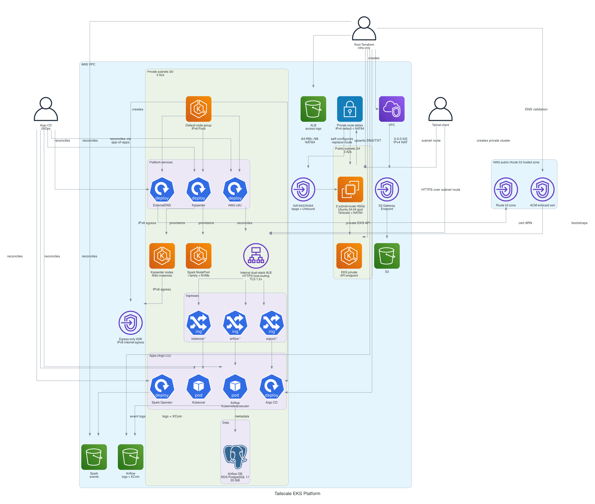

# Tailscale EKS Platform

Private Amazon EKS platform across three Availability Zones. The VPC and EKS
workloads are dual-stack, the EKS API is private, and local access goes through
the persistent Tailscale subnet-router ASG. Terraform creates AWS infrastructure
and bootstraps Argo CD; Argo CD reconciles the retained platform services.

## Architecture



Regenerate the diagram:

```bash
uv run --script docs/architecture_diagram.py
```

## Prerequisites

- Terraform `>= 1.11.0`
- AWS credentials using profile `victor`
- A public Route 53 hosted zone
- A Tailscale auth key for the subnet routers
- AWS CLI, `kubectl`, Python 3 and Helm 3

## Quick start

Create the ignored `terraform.tfvars` with the required domain, Tailscale,
Kubecost CUR, Airflow log bucket and `airflow_db_password` values. Keep the
password local; it is passed to RDS through Terraform's write-only
`password_wo` argument.

Apply infrastructure in two phases:

```bash
export AWS_PROFILE=victor
terraform init -migrate-state
terraform validate
terraform apply
```

Approve the advertised Tailscale routes:

```bash
terraform output -raw tailscale_subnet_router_hostname
terraform output -raw tailscale_subnet_route
terraform output -raw tailscale_subnet_ipv6_route
```

Set `enable_argocd_bootstrap = true` in the ignored tfvars file and apply again.
Then configure access and create the native Airflow Secrets:

```bash
aws eks update-kubeconfig \
  --profile victor \
  --region "$(terraform output -raw aws_region)" \
  --name "$(terraform output -raw cluster_name)"

export AIRFLOW_DB_PASSWORD='the same local value used by Terraform'
bash scripts/create-airflow-secrets.sh
```

The script preserves existing generated Airflow credentials and refreshes only
the database connection Secret so it points to the private RDS endpoint.

## Platform URLs

```text
https://argocd.<domain>
https://airflow.<domain>
https://kubecost.<domain>
```

## Services

Argo CD manages exactly these child Applications:

| Wave | Application | Purpose |
|---:|---|---|
| 0 | `base` | Namespaces, RBAC, ingress, PDB and network policy |
| 1 | `aws-load-balancer-controller` | Internal ALB provisioning |
| 1 | `external-dns` | Route 53 DNS records |
| 1 | `karpenter` | Node provisioning |
| 2 | `argocd` | Self-managed Argo CD |
| 3 | `karpenter-resources` | EC2NodeClass and NodePool |
| 4 | `airflow` | Airflow with KubernetesExecutor |
| 4 | `spark-operator` | Spark job management |
| 4 | `kubecost` | CUR cost analytics |

Airflow metadata uses a private single-AZ PostgreSQL 17 RDS instance:
`db.t4g.micro`, 20 GiB gp3, dual-stack, encrypted, with no automated backup or
final snapshot. Airflow task logs and XCom objects remain in the
configured S3 bucket.

## Terraform resources

| Resource | Files |
|---|---|
| Dual-stack VPC, routes and S3 endpoint | `network.tf`, `locals.tf` |
| Private EKS cluster and fixed addons for Kubernetes 1.37 | `eks.tf`, `kms.tf` |
| Tailscale subnet-router ASG and NAT64/DNS64 | `tailscale-bootstrap.tf`, `templates/bootstrap.sh.tftpl` |
| Private Airflow RDS and security group | `airflow-rds.tf` |
| Route 53, ACM and internal ALB inputs | `route53-acm.tf`, `argocd.tf` |
| Karpenter and workload Pod Identity | `karpenter.tf`, `pod-identity.tf` |
| ALB access logs, Spark events and Airflow logs | `observability.tf`, `locals.tf` |

## Secrets and data durability

Airflow application credentials are native Kubernetes Secrets created locally by
`scripts/create-airflow-secrets.sh`. No secret values are committed to Git.

The RDS configuration intentionally has no database backup, final snapshot,
Multi-AZ, read replica, Performance Insights or Enhanced Monitoring. Destroying
the database is therefore irreversible unless data is exported separately.
There is no cluster backup, metrics stack or log aggregation service; retain
important application data in the configured S3 destinations.

## Validation

```bash
bash tests/versions_static_test.sh
bash tests/eks_addons_static_test.sh
bash tests/platform_static_test.sh
bash tests/bootstrap_static_test.sh
bash tests/private_network_static_test.sh
bash tests/karpenter_static_test.sh
bash tests/kubecost_cur_static_test.sh
bash tests/rds_static_test.sh
bash tests/airflow_secrets_static_test.sh
terraform fmt -check -recursive *.tf
terraform validate
helm template platform-root gitops/root \
  --set global.repoURL=https://example.invalid/repo.git \
  --set global.targetRevision=master
```

Runtime checks:

```bash
kubectl -n argocd get applications
kubectl get nodes
kubectl get ingress -A
kubectl -n airflow get pods
kubectl -n airflow get secret airflow-db-credentials
```

## Destroy

```bash
terraform destroy
```

The database has no final snapshot and the configured S3 buckets may need to be
emptied before destruction.
